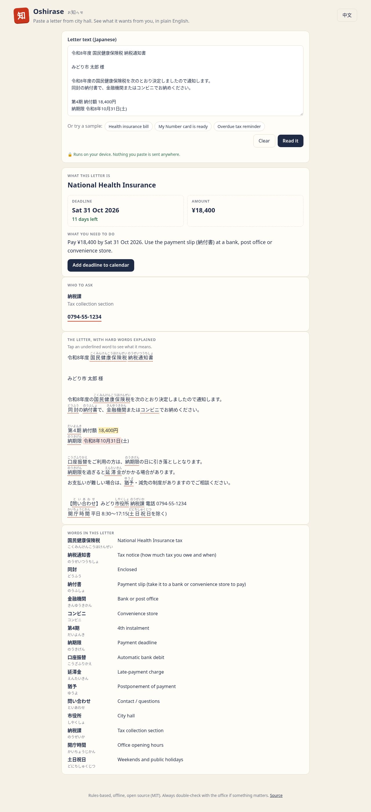

# Oshirase (お知らせ)

Paste the text of a letter from a Japanese city hall and see what it is, the deadline, the amount and what you have to do, in **English or Simplified Chinese**.

Everything runs in your browser with plain rules. No AI model, no server, no account, and nothing you paste leaves your device, which matters because these letters carry your name, address and sometimes your My Number.

**Try it:** https://yema7582-code.github.io/oshirase/ (tap one of the sample letters)



## What it does
- Recognises common letters: National Health Insurance, resident tax, pension, My Number card, residence card, property and light-vehicle tax, child allowance, check-ups, vaccinations, and overdue reminders (督促状).
- Finds the **deadline** among all the dates in the letter and converts Reiwa dates (令和8年10月31日, R8.11.6) into a normal date with a countdown.
- Finds the **amount** to pay and writes a one-line to-do: pay, send back, go to the counter, or renew your stay.
- Lists **what to bring**, the **office** to contact and tap-to-call **phone numbers**.
- Shows the letter with **furigana** over about 100 bureaucratic words. Tap one to see its meaning.
- Turns red for overdue notices and close deadlines.
- Downloads the deadline as a **calendar event** with a reminder the day before.

## Run it locally
Requires Node.js 18 or newer (only for the tiny static server and the tests; the app itself has no dependencies).

```
npm start          # http://localhost:5173
npm test           # 13 unit tests with node:test
```

Handy URL options: `?sample=nhi|mynumber|overdue` opens a sample, `?lang=zh` starts in Chinese, `?today=2026-10-20` pins today's date.

## How it was built
Planned and built with the [Devpost Learn skill pack](https://github.com/challengepost/learn-ai-basics) and an AI coding agent for the *Build With AI: Basics* hackathon. The planning documents are in [`devpost/`](devpost/): [scope](devpost/scope.md), [PRD](devpost/prd.md), [spec](devpost/spec.md) and the [build checklist](devpost/checklist.md).

Start reading the code at `src/parse.js > analyze()`. Everything the page shows comes from the object it returns.

## Limits
Oshirase explains the letter; it is not tax or legal advice. Letters differ between cities, so if the page finds no deadline, look for a date next to 期限 or まで and call the number on the letter. The sample letters are made up.

## License
MIT
